<div align="center">



**Building small tools with Claude Code. Clawd approves.**

</div>

## whoami

```text
+--------------------------------------------------------------+
| name      : Phuc Chau                                        |
| building  : Clawdometer, a Claude Code usage HUD             |
| stack     : Rust, Tauri, JavaScript                          |
| pairing   : Claude Code                                      |
| mascot    : Clawd, pixel-for-pixel                           |
+--------------------------------------------------------------+
```

## Toolbox

```text
.-----------.  .-----------.  .-----------.  .-----------.
|   CLAUDE  |  |    RUST   |  |   TAURI   |  |    GIT    |
|   ><((o>  |  |  <o)))><  |  |  ><(((*>  |  |  <*)))><  |
'-----------'  '-----------'  '-----------'  '-----------'
```

## Projects

```text
+--------------------------------------------------------------+
| CLAWDOMETER                          Rust . Tauri . Windows  |
|--------------------------------------------------------------|
| Unofficial HUD for Claude Code usage limits                  |
| Current, Weekly and Fable at a glance                        |
| Nine skins: Classic, Rowline, Bento, ClawdBoy, Orb           |
|--------------------------------------------------------------|
| Unofficial. Not affiliated with Anthropic.                   |
+--------------------------------------------------------------+
```

## Say hi

```text
+--------------------------------------------------------------+
| email : aidenmileshp@gmail.com                               |
+--------------------------------------------------------------+
```

```text
       .-""""-.         o                .
 |\   /        \                 O                O          .---.
 | >=<   ))  o  >           o                               /     \
 |/   \        /      ##########################           <o  (  ><
       `-.__.-'       ###   ##############   ###        .   \     /
                      ###   ##############   ###             `---'
               ########################################        o
         ><>   ########################################
               ########################################
  ><(((*>             ##########################
                      ##########################           <*)))><
    )     )           ###    ###      ###    ###          )     )   )
    (     (           ###    ###      ###    ###          (     (   (
    )     )           ###    ###      ###    ###          )     )   )
'::'.;,.,.:;,;'.',.,;:,;,.,'';,,..,,,,::,',,,;:.:;,,:.::''.':.:::;:,;;
,.:.:;.;:;.;.,,.,;:::;.::.;.,::,::.:::,.,:;,..;.,::;;,..;:,,,;.,;:,.;:
                  clawd says thanks for swimming by.
```
